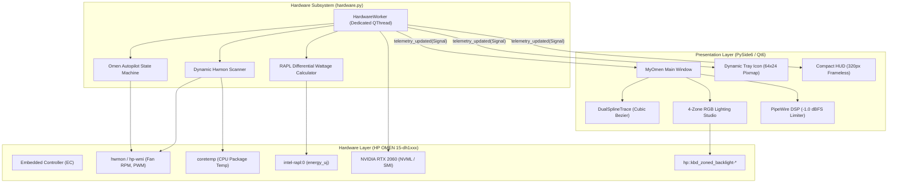

<div align="center">

# MyOmen

Public source snapshot: [hajhamouddev/myomen-clean](https://github.com/hajhamouddev/myomen-clean). Developed and adapted from **orion-sense**; see [APP.md](APP.md) and existing attribution/license notices.

Review status (26 October 2026): `python3 tests/test_logic.py` completed 113 passing checks with hardware and Qt stubbed. This is not physical-device validation. Raw ACPI/firmware dumps and binary research captures are excluded. Hardware-specific behavior and the performance claims in the historical design notes below have not been independently measured by this review.

### Next-Generation Linux Control Suite & Hardware Hub for HP OMEN Laptops

[](https://python.org)
[](https://qt.io)
[](https://kernel.org)
[](https://hp.com)
[](https://nvidia.com)
[](LICENSE)

<br/>

**MyOmen** is an hardware telemetry hub, thermal governor, and RGB lighting suite engineered specifically for **HP OMEN 15-dh1xxx** laptops running modern Linux distributions (Ubuntu 24.04+, Debian, Arch, Fedora).

</div>

---

## ⚡ Architectural Highlights

- **Dynamic Hwmon Discovery**: Eliminates hardcoded `/sys/class/hwmon/hwmonX` paths. Dynamically resolves `hp-wmi`, `coretemp`, and `pch_cometlake` nodes across kernel probe reorders.
- **Dedicated Background Telemetry QThread (`HardwareWorker`)**: Zero I/O on the main GUI thread. Offloads sysfs polling, RAPL power differentials, and NVML queries to an isolated worker emitting typed Qt signals.
- **Adaptive Telemetry Polling**:
  - `1000ms` when UI is active & visible.
  - `5000ms` when minimized to System Tray.
  - `15000ms` when running on battery power (`BAT1/status != "Charging"`).
- **Omen Autopilot (Fan Curve State Machine)**:
  - Immediate `0ms` reaction upon thermal spikes (`>75°C`).
  - 5-second thermal dwell buffer (asymmetric hysteresis) before ramping fans down, eliminating annoying fan hunting noise.
- **Dual-Spline Live Graph (`DualSplineTrace`)**:
  - Catmull-Rom cubic Bézier splines (`QPainterPath`) simultaneously plotting CPU (`#00B4D8`) and GPU (`#FF1A35`) thermal history with semi-transparent alpha gradient fills.
- **Direct GPU Telemetry**:
  - Sub-millisecond queries via `pynvml` / ctypes NVML (`libnvidia-ml.so.1`).
  - Graceful fallback to non-blocking asynchronous worker parsing `nvidia-smi`.
  - Low-power D3cold detection preventing PCIe bus micro-stutters.
- **4-Zone RGB Lighting Studio**:
  - Full control over Zone 1 (Left), Zone 2 (Center), Zone 3 (Right), Zone 4 (WASD).
  - 0% to 100% brightness scaling. At 0%, sends power-down command to the LED controller IC to conserve energy.
  - 10 Built-in curated presets including *Ice Cold*, *Cyberpunk Neon*, *Omen Crimson*, *Deep Matrix*, *Breathing Wave*, and *Stealth Mode*.
- **PipeWire Audio DSP Tuning**:
  - Standalone user filter-chain with hard peak limiter set strictly at `-1.0 dBFS` to prevent speaker clipping distortion.
  - Parametric EQ tuned to match HP Windows B&O sound profile.
- **System Tray & Flyout HUD**:
  - Dynamic in-memory `64x24` pixmap icon displaying live `CPU° GPU°` with a 4px health status dot.
  - Compact `320px` frameless popover HUD featuring live load strips, wattage readouts, fan speeds, Max Fans toggle, power profile switcher, and quick RGB chips.

---

## 🏗️ Architecture & Data Flow



---

## 💻 Supported Hardware Matrix

| Subsystem | Hardware Specification | Linux Driver / Interface | Status |
| :--- | :--- | :--- | :--- |
| **System Board** | HP 8746 (OMEN 15-dh1xxx) | `hp-wmi` (ACPI GMxx) | Target board; physical validation pending |
| **CPU** | Intel Core i7-10750H (Comet Lake) | `coretemp` / `intel_rapl` | ✅ Dynamic |
| **GPU** | NVIDIA GeForce RTX 2060 Mobile | Proprietary Driver + NVML | NVML telemetry integration |
| **Fans** | Dual EC High-Static Pressure | `hp-wmi` `fan1_input` / `fan2_input` | ✅ Live RPM & Max Toggle |
| **Keyboard** | 4-Zone RGB Zoned Backlight | `leds-hp-wmi` sysfs nodes | ✅ 10 Presets & Dimming |
| **Audio** | Bang & Olufsen Stereo Speakers | PipeWire Filter-Chain | ✅ -1.0 dBFS Brickwall Limiter |

---

## 🚀 Installation & Deployment

### Universal One-Click Automated Installer
Run the automated installer from the repository root:

```bash
./install.sh
```

The installer automatically:
1. Resolves and installs system dependencies (`python3-pyside6`, `lm-sensors`, `pipewire`, `wireplumber`).
2. Verifies the `hp_wmi` kernel module.
3. Installs udev rules to `/etc/udev/rules.d/99-myomen.rules` for non-root hardware control.
4. Deploys the scalable SVG icon and desktop entry (`myomen.desktop`).
5. Configures autostart in background tray mode (`--tray`).

### Clean Uninstallation
To completely remove MyOmen without touching base system packages:

```bash
./uninstall.sh
```

---

## 🎮 Usage Guide

### Launching the Application
- **Interactive UI**:
  ```bash
  myomen
  ```
- **Background Tray Mode**:
  ```bash
  myomen --tray
  ```

### CLI Quick Controls
```bash
# Check complete real-time hardware status
myomen status

# Instant power profile switching
myomen power performance   # Quiet, Balanced, Performance

# Toggle forced maximum fans
myomen fan max

# Apply 4-Zone RGB layout preset
myomen light --layout ice
```

---

## 🎨 4-Zone RGB Presets

| Preset | Hex Code | Visual Profile |
| :--- | :--- | :--- |
| **Ice Cold** | `#A0E7E5` | Crisp Arctic glacial frost with diamond white WASD |
| **Cyberpunk Neon** | `#FF007F` / `#00F5D4` | High-contrast synthwave split between Neon Pink & Aqua Cyan |
| **Omen Crimson** | `#FF1A35` | Signature HP OMEN battle-ready crimson red |
| **Deep Matrix** | `#00FF41` | Phosphor hacker green glowing across all keys |
| **Golden Amber** | `#FFB703` | Warm tungsten amber glow for late night coding |
| **Ghost White** | `#F8F9FA` | Pure clean daylight white illumination |
| **Solar Flare** | `#FB8500` | Radiant molten solar orange and hyper-gold |
| **Ultraviolet** | `#7209B7` | Deep electric ultraviolet neon aura |
| **Breathing Wave** | Dynamic | Dynamic thermal-linked pulse reacting to system temperatures |
| **Stealth Mode** | `#000000` | 0% brightness, all LEDs and controller powered down |

---

## 🛡️ License

This project is licensed under the MIT License - see the [LICENSE](LICENSE) file for details.  
Copyright (c) 2026 Haj Hamoud.
